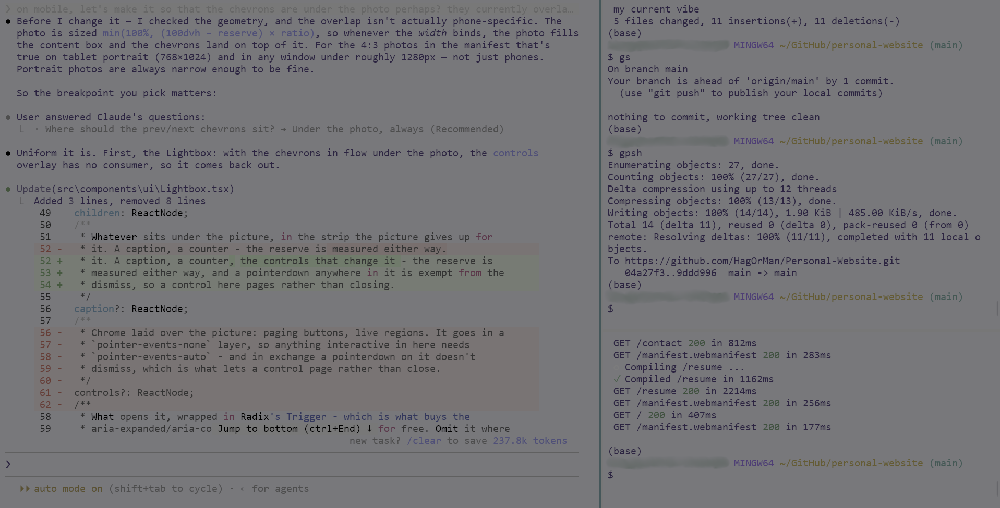
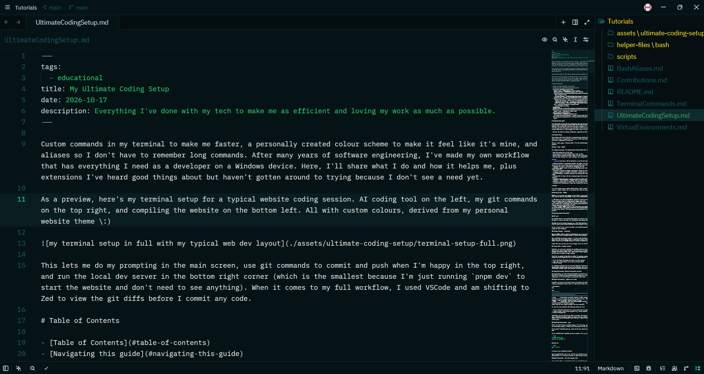
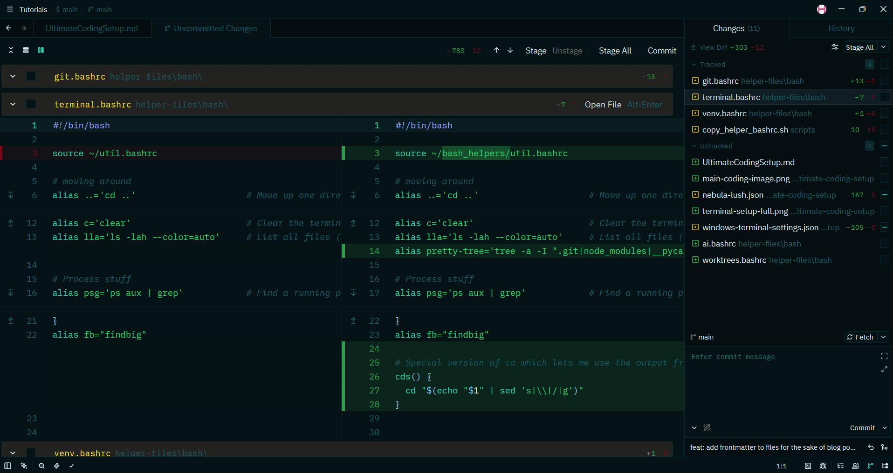

---
tags:
  - educational
title: My Ultimate Coding Setup
date: 2026-10-17
description: Everything I've done with my tech to make me as efficient and loving my work as much as possible.
---

Custom commands in my terminal to make me faster, a personally created colour scheme to make it feel like it's mine, and aliases so I don't have to remember long commands. Over many years of coding, I've made my own workflow that has everything I need as a developer on a Windows device. Here, I'll share what I do and how it helps me, plus extensions I've heard good things about but haven't gotten around to trying because I don't see a need yet.

As a preview, here's my terminal setup for a typical website coding session. AI coding tool on the left, my git commands on the top right, and compiling the website on the bottom right. All with custom colours, derived from my personal website theme \:)



This lets me do my prompting in the main screen, use git commands to commit and push when I'm happy in the top right, and run the local dev server in the bottom right corner (which is the smallest because I'm just running `pnpm dev` to start the website and don't need to see anything). When it comes to my full workflow, I used VSCode and am shifting to Zed to view the git diffs before I commit any code.

# Table of Contents

- [Table of Contents](#table-of-contents)
- [Navigating this guide](#navigating-this-guide)
- [My Overall Setup](#my-overall-setup)
  - [Where I Code - VSCode](#where-i-code---vscode)
  - [Storing My Code - GitHub](#storing-my-code---github)
  - [Operating System Environments](#operating-system-environments)
    - [OS Level](#os-level)
    - [Package Managers - Chocolatey](#package-managers---chocolatey)
  - [Terminal Work - Windows Terminal](#terminal-work---windows-terminal)
  - [Coding Environments (Virtual Environments and more)](#coding-environments-virtual-environments-and-more)
    - [Python Environments - python venv \& conda](#python-environments---python-venv--conda)
    - [TypeScript Environments - pnpm](#typescript-environments---pnpm)
    - [Node Environments - fast node manager (fnm)](#node-environments---fast-node-manager-fnm)
  - [ssh - using Git Bash](#ssh---using-git-bash)
    - [ssh Config](#ssh-config)
- [Bash](#bash)
- [Adding Shortcuts to Speed Up Everything Else](#adding-shortcuts-to-speed-up-everything-else)
- [Extensions to Previous Sections](#extensions-to-previous-sections)
  - [Where I Code - Zed](#where-i-code---zed)
  - [Colour Schemes](#colour-schemes)
    - [Adding The Colour Scheme in Zed](#adding-the-colour-scheme-in-zed)
    - [Adding The Colour Scheme in Windows Terminal](#adding-the-colour-scheme-in-windows-terminal)
- [Coding Photos](#coding-photos)
  - [File Editing - Zed](#file-editing---zed)
  - [Viewing Code Changes - Zed](#viewing-code-changes---zed)
  - [AI Coding and Running Websites - Windows Terminal with Git Bash](#ai-coding-and-running-websites---windows-terminal-with-git-bash)
- [More Design-Focused Apps](#more-design-focused-apps)

# Navigating this guide

I'll start with my main setup for programming, then get into aspects of it used for efficiency that seem more generalizeable to developers overall. These will be broken into sections that are hopefully clear based on the table of contents. Each section will start with the goal or problem I'm solving, and end in specifically how I accomplished it. I'll later get into other parts of my setup that I still feel might be valuable to someone. Scattered between, I'll include alternatives or other thoughts for stuff I haven't tried but think might be helpful.

> Overall, the table of contents should give a good idea of what the guide contains.

# My Overall Setup

Each of these will start with what I recommend having started with them myself, and then any extensions I later made to improve the setup. I'm organizing it this way so that anyone getting started can begin with the basics and come back once they're comfortable to learn more.

Because a photo speaks a thousand words, I'll also include photos [here](#coding-photos) showing my general development pipeline.

## Where I Code - VSCode

For coding environments, the quintessential Visual Studio Code is my main workspace. In it, I have:

- Easy file editing for any file type
- Git tracking to view what changed since I made my edits
- Global search to quickly find text within even the largest repositories
- Plus fun other features for LaTeX, markdown, and viewing PDFs!

<details>
    <summary>I also have a LOT of extensions so see the most important ones here!</summary>

- **Black Formatter**: opinionated formatter for python. It automatically formats for you on save. Keeps things clean especially when collaborating.
- **Debugger for Java**: convenient for debugging java code
- **ESLint**: helpful linter to check javascript/typescript code (analyzes the code to catch bugs for you, like missing import statements)
- **Jupyter**: support for jupyter environments, making it a lot easier to use notebooks in vscode
- **Language Support for Java(TM) by Red Hat**: exactly what it sounds like
- **LaTeX Workshop**: incredible extension for working with LaTeX! Also all the features you need for viewing PDFs in vscode
- **Markdown All in One**: the best markdown helper that also allows for fun features like an auto-updating table of contents!
- **PostCSS Language Support**: quality of life for working with CSS
- **Prettier - Code formatter**: helpful code to format javascript/typescript code instead of python
- **Python**: exactly what it sounds like (I'd just get the official extension for any language you work with)
- **Tailwind CSS IntelliSense**: helps make tailwind CSS code super easy

</details>

I've also started using an editor called **Zed**, which I would recommend but will go into some considerations before using in a future section. It's a lot faster and I like its interface more, so I do recommend giving it a try!

## Storing My Code - GitHub

GitHub is my main place for storing my code and for a good reason. It's easy to use and gives lots of functionality for free. When it comes to using GitHub, I have a few recommendations:

1. Add aliases (see below [bash](#bash) section) to speed up your use of git, or use built-in tools in your IDE (you feel a lot cooler doing it in the terminal though, trust me).
2. Add a signing key to your GitHub to have all of your commits be verified as yours (hopefully GitHub's official guide never changes their [link](https://docs.github.com/en/authentication/managing-commit-signature-verification/adding-a-gpg-key-to-your-github-account)).
3. Create a profile README (create a repo named after your username, and the `README.md` file you make there will show up on your profile). Many people online have made [resources](https://github.com/topics/github-profile-readme-generator) to help you get started. This helps bring some personality to your GitHub if you care about being recognized for your projects.

## Operating System Environments

### OS Level

On a Windows device, many commands that people are used to in programming (Unix-like commands) aren't available. I like Git Bash as a way to run these, but alternatives like Windows Subsystem for Linux (WSL) also exist.

Git Bash is easy to install and gives you a Unix-like interface right in your terminal. Common commands like `ls` to list all files in the current directory are now available, and everything I need as a programmer is available here.

So far, I haven't seen a need to use WSL or any emulated operating systems, so I think this simple enhancement is good enough for most developers.

### Package Managers - Chocolatey

Many incredible software requires downloading to use on your device. For example, a local LaTeX installation like MikTeX. You'll want a package manager to install these packages.

When installing new package managers, I've been using Chocolatey because WinGet (the native windows package manager) didn't have all of the packages that I wanted when I first started installing things. Both are good, I'd stick with WinGet if you're new to things because it's native to Windows and likely handles everything you need for now.

**Just make sure you only ever use one manager, don't mix and match.**

## Terminal Work - Windows Terminal

Sometimes, you just need a terminal for something quick and easy. Why boot up a whole IDE like VSCode if you're just going to run a small command? There's a lot of ways to use terminals to make your life easier. Sometimes, I'll open a terminal and work from there, but I often prefer a hybrid approach of using my Windows File Explorer to find what I need and then open a terminal to begin working.

First off, an example of why this is useful: I'm running a command on my device to compress a video. I installed a package for video compression and it runs through the terminal. I:

1. Go to the folder that holds the video in my file explorer
2. Type `cmd` in the address bar to open up command prompt
3. Run the command

So, **Windows Terminal** has to be the best thing for terminal work, especially since newer versions of Git Bash automatically integrate with it when you install them. It's a lot faster because it's native to Windows, so integrate with Windows Terminal rather than using the standalone Git Bash app.

I also have all my commands and colour schemes available [here](assets/ultimate-coding-setup/windows-terminal-settings.json)! Just copy the sections you want (e.g., the `schemes` section) into your Windows terminal `settings.json`. Access it by clicking `Ctrl+,` and then clicking `Open JSON File` in the bottom left.

## Coding Environments (Virtual Environments and more)

When programming, you need to keep environments separated to ensure you never run into package conflicts (see my old tutorial on [virtual environments](VirtualEnvironments.md) if you're curious). Most of my coding is Python and Javascript/Typescript, so I'll be focusing on environments within those.

### Python Environments - python venv & conda

In python, you have two main ways to get an environment. An external package manager like conda and native python virtual environments (venvs). Here's a small pro/con table from how I use them:

| Environment | Pros                                                                                                                                                                | Cons                                                                                                              |
| ----------- | ------------------------------------------------------------------------------------------------------------------------------------------------------------------- | ----------------------------------------------------------------------------------------------------------------- |
| Conda       | Environments accessible anywhere, handles non-python dependencies as well if you work across languages, and makes it easy to manage many versions of python at once | More disk usage because it fully installs all new packages, slower to install, slightly harder to manage          |
| Python      | Lightweight, fast, uses cached package installs, native to python, easy to delete virtual environments and keep attached to individual projects                     | Doesn't natively handle non-python libraries, requires manual setup for more complex packages like ones using GPU |

So, here are some situations that determine which one I use:

- I want a dedicated environment for a given project ==> use python venv, installed in the project folder
- I want to reuse a stack across projects (e.g., school projects all using some data science packages) ==> use conda so I install everything once

Technically, you can stick to one stack if you want. The reason I don't always use python venvs is that even if I can make a dedicated environment folder and access them from anywhere, I find it easier to keep the environments in the same folder as the rest of the project code. That way, I know it's there, it's easy to start up, AND delete if I want to reclaim space.

### TypeScript Environments - pnpm

First, you need to choose a package manager. I've been using `pnpm` because it seems like a faster alternative to `npm`, the most common manager. It takes up less disk space and from anecdotal evidence, runs my code much faster.

If you haven't installed node yet, check out the next section because the following commands for installing pnpm rely on that.

If you installed node, hopefully you have corepack. If so, you can install pnpm simply with

```bash
corepack enable pnpm
corepack use pnpm@latest
```

And then run

```bash
pnpm --version
```

to ensure it was installed correctly.

pnpm is supported the same as npm, and for many commands you can simply use `pnpm` instead of `npm`. Most library documentations I've seen have an option to copy the pnpm version because it's so commonly used.

### Node Environments - fast node manager (fnm)

If you code in Node, an environment manager is essential because you will eventually need to upgrade your node version.

I use fast node manager (fnm). If you use WinGet which I would now recommend (see [above](#package-managers---chocolatey)), install it with

```bash
winget install Schniz.fnm
```

The great thing about fnm is that it can automatically change your node version depending on the project you're using, so you don't even need to manually change it. That said, their help documentation is very good and it's super simple to change. Commands as simple as `fnm use 22` to switch to your installed node v22.x.x version.

If you're using it in Git Bash, this functionality is available with the below which I highly recommend adding to your `.bashrc` file (see mine [below](#bash)):

```bash
eval "$(fnm env --use-on-cd)"
```

## ssh - using Git Bash

If you've ever worked with servers, you've probably had to ssh into them. ssh stands for `Secure Shell` and is the default way to connect to servers. I enjoy using Git Bash for my ssh but the configuration is identical for Windows, and is built into windows terminals as well as Git Bash.

### ssh Config

This is by far one of the best things about ssh in bash. With a config file, you specify where you want to ssh into and which identity files you use for them. Rather than remembering the ssh command, you just type `ssh myserver` to go into the server you want.

This is done by making a config file in your `.ssh/` folder, which would look like this

```bash
# ~/.ssh/config
Host myserver
    HostName 192.168.1.50
    User ubuntu
    Port 22
```

# Bash

On Windows, being able to use bash commands is so helpful. My favourite bit is aliases which I have another [tutorial](BashAliases.md) on, and I've shared all my aliases on GitHub [here](helper-files/bash/).

Because it isn't included there, but needed for it to work, you also have to make a `.bashrc` file if you don't have one already. My setup is all of the helper `*.bashrc` files are in `~/bash_helpers/`, just to keep things clean.

So that you don't need to make it by hand, my `.bashrc` file contains references to all of the dedicated alias files, plus some other setup

```bash
# Load other scripts
source ~/bash_helpers/util.bashrc
source ~/bash_helpers/git.bashrc
source ~/bash_helpers/terminal.bashrc
source ~/bash_helpers/venv.bashrc
source ~/bash_helpers/npx.bashrc
source ~/bash_helpers/ai.bashrc
source ~/bash_helpers/worktrees.bashrc

# Fast node manager setup
eval "$(fnm env --use-on-cd --shell bash)"
eval "$(fnm completions --shell bash)"

# --------- SSH ---------
# Start ssh-agent if not already running
eval $(ssh-agent -s) > /dev/null

# Add signing key silently if not already loaded
ssh-add -l &>/dev/null || ssh-add ~/.ssh/id_ed25519_signing &>/dev/null

# --------- VS Code ---------
# Done because vscode needs this somehow to see what I have in my path with ruby installations
export PATH="/c/tools/ruby34/bin:$PATH"
export PATH="$HOME/.gem/ruby/3.4.0/bin:$PATH"
```

# Adding Shortcuts to Speed Up Everything Else

Sometimes, there's apps that you have that don't natively let you open them from file explorer. Don't fret, you can just add that command yourself!

For example, I wanted to open Matlab into any folder from my file explorer. Because it didn't let me do this by default, I made a .reg file called `AddMatlabOpenButton.reg` and ran it.

```reg
Windows Registry Editor Version 5.00

[HKEY_CLASSES_ROOT\Directory\shell\MATLAB]
@="Open in MATLAB"
"Icon"="\"C:\\Program Files\\MATLAB\\R2025a\\bin\\matlab.exe\""

[HKEY_CLASSES_ROOT\Directory\shell\MATLAB\command]
@="\"C:\\Program Files\\MATLAB\\R2025a\\bin\\matlab.exe\" -sd \"%1\""
```

Now, any time I opened matlab from the file explorer, I could choose which folder it opened in! All I had to do was double click the `.reg` file in my file explorer, give permission to run it, and now the functionality was available.  
(for all I know newer versions do this by default)

# Extensions to Previous Sections

## Where I Code - Zed

Zed has such a clean layout and I find it much more responsive than VSCode. I'll start by describing why you DON'T want to move to it, and then go into the pros, since there are some use cases that just don't work.

**What doesn't work:**

- Extensions - some extensions available on VSCode aren't on Zed. For example, the LaTeX extension in VSCode that supports compiling PDFs on save and then viewing them in VSCode isn't on Zed (mostly because Zed simply doesn't allowing viewing PDFs within the app).
- Notebooks - VSCode has fantastic built in support for notebook files (`.ipynb`), replacing using apps like Jupyter Notebook. I love doing data science work in VSCode for this reason, and Zed simply cannot replace it.
- Viewing anything other than text really - I like being able to view image files in VSCode as I work on website-related apps, but Zed doesn't support viewing images inline.

**Why you should otherwise use Zed:**

- The editing is smooth and their keybindings can be directly ported from VSCode if you prefer its setup.
- I much prefer their Git Diff where you view the changes to all the files since your last commit. It lets you scroll through all them like in GitHub (when you're reviewing a PR) and check each one off as you go.
- Collaborative coding feels much smoother. I've tried the VSCode Liveshare before but Zed project sharing has worked a lot better for me.

I've also shared my Zed colour schemes [here](assets/ultimate-coding-setup/nebula-lush.json)! Just add it to your user profile at `\AppData\Roaming\Zed\themes`.

## Colour Schemes

I love the idea of personalization and having things that are truly yours. For example, I once did a perfume workshop with my girlfriend and we made our own custom scents. The same thing applies here with colour schemes.

What I did is I started by taking the colour scheme of my website. I made this with lots of trial and error and online tools that are no longer free (to play with colour combos). Once I had that colour scheme in the website, it was as quick as prompting AI (Gemini in my case) to create a colour scheme for Windows Terminal and Zed given the colour scheme, focusing on the colours I wanted (purple in light mode and teal/turqoise in dark mode).

### Adding The Colour Scheme in Zed

For Zed, if you want to add it, find it [here](assets/ultimate-coding-setup/nebula-lush.json)! Just add it to your user profile at `\AppData\Roaming\Zed\themes`. After that, Zed automatically detects it. In my Zed settings.json, I also added

```json
"theme": {
    "mode": "dark",
    "light": "Nebula Lush Light",
    "dark": "Nebula Lush Dark",
  },
```

I then edited my keymap.json in Zed and added this

```json
{
    "context": "Workspace",
    "bindings": {
      "ctrl-alt-t": "theme::ToggleMode",
    },
  },
```

This lets me switch the theme from light to dark with `ctrl+alt+t`. Very helpful if my mood or lighting in the room changes.

You can get to the keymap by clicking `ctrl+,` to open settings, then typing `keymap` into the search bar, and then clicking the `Open Keymap` button that appears under the `Base Keymap` page in `Edit Keybindings`.

### Adding The Colour Scheme in Windows Terminal

You can access my colour scheme [here](assets/ultimate-coding-setup/windows-terminal-settings.json)! Just copy the sections you want (e.g., the `schemes` section) into your Windows terminal `settings.json`. Access it by clicking `Ctrl+,` and then clicking `Open JSON File` in the bottom left.

You'll also notice some other commands in there. A few of these let me press `ctrl+alt+l` to switch to light mode and `ctrl+alt+d` for dark mode. Pretty cool if I may say so myself.

# Coding Photos

## File Editing - Zed


My custom dark mode colour scheme in Zed! Here's the editor, on the right side where the file explorer shows the new file (the one I'm working on) in green while modified folders are yellow.

## Viewing Code Changes - Zed


Here's how I look through code changes! I prefer this to VSCode because I can click on files on the right to see specific ones, or just scroll through all the changes. It also lets me click the checkbox as I go to indicate that I'm happy with the changes and stage them.

## AI Coding and Running Websites - Windows Terminal with Git Bash


The same photo as the start, but now I'll go more in depth. Majority of the screen goes to Claude Code for viewing everything nicely. The top right is for my git commands, so my workflow is `gaa` to stage the files and then `gc "feat: what I changed"`, and finally `gpsh` to upload the changes to GitHub.

The bottom right section is just for running `pnpm dev` and other commands, as you can see by the code from running the website locally like `Get / 200 in 487 ms` being when I went on the main page of my website.

Fun fact: this colour scheme is the same as my light mode one in Zed!

# More Design-Focused Apps

While I don't do much design, here's a few apps I like and how I've used them:

- **Krita:** amazing free photo editor. I've used it to edit images for my freelance work, blur content before posting stuff online (like the image [above](#ai-coding-and-running-websites---windows-terminal-with-git-bash) for my windows terminal)
- **Photopea:** free web-based photo editor. Less functionality than Krita but good for quick edits. I mostly use it to remove the background from photos if I want the asset as a png with a transparent background.
- **Obsidian:** I think this one is well known for note-taking and its graph feature. I honestly really just like the UI for editing markdown files and mostly use it as storage. The graph is an extra fun feature to view what kinds of topics I contribute to the most. Also, Excalidraw (my favourite web design app) has a plugin so you can work on files locally rather than in your browser!
- **OBS Studio:** This is great for recording demo videos. You set up screens that you can to record, can add a video of your face talking, and put that in some corner.
- **CapCut:** Pretty sure this one is for TikTok videos, but I use it for anything and everything. Its voice isolation is currently free and is honestly the best free app I've found for removing background noise from your audio while maintaining quality.
